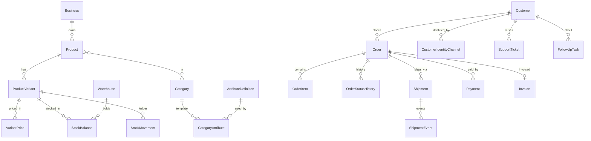
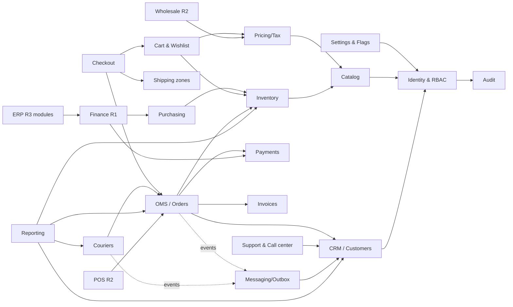

# Architecture

## 1. Style

**Modular monolith** on Next.js App Router, organized in layers:

```
app/ (routes, server components, server actions, route handlers)   ← presentation
  └─ calls → modules/<domain>/service.ts                            ← domain services (authz + validation + transactions)
                └─ modules/<domain>/repository.ts                    ← data access (Prisma only here)
                └─ lib/events (outbox.enqueue in same tx)            ← async side-effects
jobs/worker.ts (pg-boss) → outbox dispatcher → integrations/<port>/<provider>.ts
```

Rules:
- Routes never import Prisma directly. All reads and writes go through a module service that receives an authenticated `Actor` and checks permissions (deny by default).
- Every privileged write produces an `AuditLog` row in the **same transaction**.
- External side-effects (SMS, email, courier booking, webhooks) are never performed inside a business transaction. The transaction writes an `OutboxEvent`, and a worker delivers it with an idempotency key.
- Client input is never trusted for prices, totals, stock, roles or ownership. All of these are recomputed or looked up on the server.

## 2. Repository layout

```
src/
  app/
    (storefront)/        public shop: /, /shop, /categories/[slug], /products/[slug], /search, /cart, /checkout, /pages/[slug]
    account/             customer area
    admin/               back office
    api/                 health, webhooks/<provider>, auth handler, exports
  components/
    ui/                  design-system primitives (Button, Input, Card, Badge, Table, Dialog, Toast, EmptyState…)
    storefront/  admin/  account/   layout/feature components
  config/                site + module registry (feature flags, release, build status)
  modules/               identity, catalog, pricing, inventory, purchasing, cart, checkout, oms, crm,
                         support, couriers, payments, invoices, messaging, reporting, settings, audit
    optional/            pos, wholesale, distribution, accounting, hr, production, imports, approvals
  integrations/          courier/, sms/, email/, payment/, meta/, voice/  (port + providers)
  lib/                   db, env, logging, money, phone, permissions, events, jobs, storage, csv, validation
  generated/prisma/      Prisma client output (git-ignored)
prisma/                  schema.prisma, migrations/, seed.ts
tests/                   unit/, integration/, e2e/
```

## 3. Domain data model (target; built per gate)

Conventions: `cuid` string IDs; `createdAt`/`updatedAt` on all tables; money as `Int` minor units plus a `currency` column (D-005); soft archive via `archivedAt`/status rather than hard delete wherever transactions reference the row; `businessId` on aggregate roots (D-001).

### Identity and access (Gate 2)
- **Business** (id, name, legalName, currency, timezone, country)
- **User** (email, phone, name, emailVerified, kind: `STAFF|CUSTOMER`, status, mfaEnabled), **Session**, **Account** (Better Auth credentials), **Verification**
- **Role** (businessId, key, name, isSystem), **Permission** (key like `orders.update`), **RolePermission**, **StaffMember** (userId, businessId, roleId, warehouse/team scope)
- **AuditLog** (businessId, actorId, action, entityType, entityId, before/after JSON (redacted), reason, ip, userAgent, correlationId, createdAt) is append-only

### Catalog (Gate 2)
- **Category** (parentId, slug, name, sort, status, attribute template), **Brand**, **Collection** + CollectionProduct
- **AttributeDefinition** (code, label, type `TEXT|NUMBER|DATE|BOOLEAN|SELECT|MULTI_SELECT`, unit, validation JSON, required, filterable, searchable, isVariantAxis, options[])
- **CategoryAttribute** (categoryId, attributeDefinitionId, required override, sort) defines category templates: Clothing gets size/color/material/fit; Cosmetics gets shade/skin type/ingredients plus batch/expiry tracking; Gadgets gets model/specs/warranty plus serial tracking
- **Product** (businessId, slug, title, description, brandId, productType `SIMPLE|VARIANT|BUNDLE`, status `DRAFT|ACTIVE|ARCHIVED`, publishedAt, SEO fields, taxClassId, trackingMode `NONE|BATCH|SERIAL`, returnPolicy)
- **ProductCategory** (many-to-many, isPrimary), **ProductAttributeValue** (typed columns: text/number/date/bool/optionId)
- **ProductVariant** (sku unique per business, barcode, title, isActive, weightGrams, dimensions, costPrice, position), **VariantOptionValue** (variantId, attributeDefinitionId, optionId)
- **ProductMedia** (productId, variantId?, storageKey, alt, width, height, mime, sort)
- **PriceList** (code `RETAIL` default, `WHOLESALE` in R2), **VariantPrice** (priceListId, variantId, amount, compareAtAmount, startsAt, endsAt), **TaxClass**
- **Traceability** (variantId, batchNo, lotNo, expiryDate, serialNo, warrantyMonths) is used only where the category's tracking mode requires it

### Inventory and purchasing (Gate 3)
- **Warehouse** (businessId, code, name, address, isDefault)
- **StockBalance** (warehouseId, variantId, onHand, reserved, damaged, quarantined; `available = onHand − reserved`; CHECK constraints keep each ≥ 0 and `reserved ≤ onHand`). It is a materialized aggregate updated in the same transaction as each movement.
- **StockMovement** (append-only ledger: type `RECEIPT|SALE|RESERVE|RELEASE|ADJUSTMENT|RETURN_RESTOCK|DAMAGE|TRANSFER_IN|TRANSFER_OUT`, qty, reasonCode, note, actorId, sourceType/sourceId, unitCost)
- **StockReservation** (orderId, variantId, warehouseId, qty, status `ACTIVE|RELEASED|CONSUMED`, expiresAt)
- **Supplier**, **PurchaseOrder** (status `DRAFT|SUBMITTED|PARTIALLY_RECEIVED|RECEIVED|CANCELLED`), **PurchaseOrderItem**, **GoodsReceipt** + **GoodsReceiptItem**
- Concurrency: stock decrements use `UPDATE … SET reserved = reserved + $q WHERE reserved + $q <= onHand` (conditional update, check affected rows) inside the order transaction. Overselling is rejected at the database level, not just in application code.

### Commerce and OMS (Gates 3–4)
- **Cart** / **CartItem** (customer or anonymous token, variantId, qty; no prices stored as truth), **WishlistItem**, **Coupon** + CouponRedemption
- **Order** (businessId, number, publicToken, source `WEBSITE|FACEBOOK_MANUAL|PHONE|POS|WHOLESALE|OTHER`, status, paymentStatus, fulfillmentStatus, customerId, contact and address **snapshot** JSON, subtotal/discount/shipping/tax/total, currency, idempotencyKey (unique), createdById, assignedToId, riskFlags)
- **OrderItem** (snapshot: productTitle, variantTitle, sku, attributes, unitPrice, qty, discount, tax, lineTotal, unitCostAtFulfilment)
- **OrderStatusHistory** (from, to, actorId, reason, at), **OrderNote** (internal), **OrderConfirmationTask**
- **ReturnRequest** / **ReturnItem** (condition, restockDecision), **Refund**, **CreditNote**

### Fulfilment and couriers (Gates 4 and 6)
- **CourierProvider** (code, name, mode `MANUAL|API`, status `UNCONFIGURED|SANDBOX|ACTIVE|DISABLED`), **IntegrationCredentialReference** (points to a secret manager key, never the raw secret in DB plaintext)
- **Shipment** (orderId, providerId, trackingCode, consignmentId, status per SRS §9, codAmount, chargeAmount, bookedAt), **ShipmentEvent** (providerStatusRaw, mappedStatus, occurredAt, source `MANUAL|WEBHOOK|POLL`, dedupKey unique)
- **TrackingException** (MISSING, STUCK, DAMAGED…), **CODRemittance** + items, **CourierCharge**
- **ShippingZone** / **ShippingRate** (district/upazila mapping, fee, codAllowed)

### Payments and invoices (Gate 4)
- **Payment** (orderId, method `COD|GATEWAY|CASH|BANK`, status per SRS §9, amount, collectedAt), **PaymentTransaction** (provider events, signature verified flag)
- **Invoice** (number sequential per FY, orderId, issuedAt, totals snapshot, pdfStorageKey), **InvoiceSequence** (businessId, fiscalYear, nextValue; locked FOR UPDATE)

### CRM and support (Gate 5)
- **Customer** (businessId, userId?, name, primaryPhoneE164, email, type `RETAIL|WHOLESALE`, status), **CustomerIdentityChannel** (type `PHONE|EMAIL|FACEBOOK_PSID|…`, value normalized, verified; unique per business), **CustomerAddress** (division, district, upazila/thana, area, line1, postcode, phone)
- **CustomerConsent** / **ConsentLog** (channel, purpose `TRANSACTIONAL|MARKETING`, granted, source, at)
- **CustomerTag** + assignments, **CustomerNote**, **CRMLead** (stage), **Interaction** (channel, direction, summary, actorId), **FollowUpTask** (assigneeId, dueAt, status), **CallLog** (disposition), **SupportTicket** + **SupportMessage** (internal flag), SLA fields

### Messaging, events and integration (Gate 6)
- **NotificationTemplate** (event, channel, locale, body), **MessageDispatch** (status `QUEUED|SENT|DELIVERED|FAILED|SKIPPED_NO_CONSENT|UNCONFIGURED`, providerMessageId, attempts), **Campaign**, **AutomationRule** (R2)
- **OutboxEvent** (type, payload, status, attempts, availableAt, idempotencyKey unique), **WebhookEvent** (provider, externalId unique, signatureValid, payload, processedAt)

### Settings and content
- **BusinessSettings**, **FeatureFlag** (moduleKey, enabled), **StorefrontTheme**, **ContentPage**, **Banner**/**Campaign** placements, **Expense** (R1 finance)

### Later modules (R2/R3, each a separate bounded project)
POSRegister, POSShift, RetailLocation, Dealer, SalesRep, DistributionRoute, AccountingAccount, JournalEntry, AR/AP, Employee, Attendance, LeaveRequest, BOM, WorkOrder, ImportExportShipment, LCDocumentReference, ApprovalRequest.

### Core ER sketch



## 4. Key indexes (SRS §12)
`(businessId, sku)` unique; `(businessId, slug)` unique on Product/Category; Order `(businessId, number)` unique, `(businessId, status, createdAt)`, `(businessId, source, createdAt)`, `(customerId, createdAt)`, `idempotencyKey` unique; StockBalance `(warehouseId, variantId)` unique; StockMovement `(variantId, createdAt)`; Shipment `(providerId, trackingCode)`; CustomerIdentityChannel `(businessId, type, value)` unique; AuditLog `(entityType, entityId, createdAt)`; OutboxEvent `(status, availableAt)`.

## 5. Module dependency map (E)



Build order follows the arrows: identity → catalog/pricing → inventory → CRM core → cart/checkout → OMS → payments/invoices → couriers → messaging → reporting.

## 6. Roles and permission matrix (draft for Gate 2 sign-off)

Permission key format: `<module>.<verb>`. Verbs are `view, create, update, delete, archive, export, approve, refund, reconcile, pii`. **Deny by default.** `pii` grants unmasked phone, email and address.

| Module \ Role | Owner | Store admin | Catalog mgr | Order agent | Courier op | CRM agent | Marketing | Finance | Inventory op |
|---|---|---|---|---|---|---|---|---|---|
| catalog | all | all | all | view | – | view | view | view | view |
| inventory | all | all | view | view | – | – | – | view | all except delete |
| purchasing | all | all | view | – | – | – | – | view, approve | create, update, view |
| orders | all | all | – | view, create, update, pii | view, update (fulfilment) | view, pii | – | view | view |
| couriers | all | all | – | view | all except delete | view | – | view, reconcile | – |
| customers/crm | all | all | – | view, create, pii | view (masked) | all except delete | view (consented), export | view | – |
| support | all | all | – | view, create | view | all | – | – | – |
| messaging | all | all | – | view | – | view, create | all | – | – |
| payments/invoices | all | view, create | – | view | view | – | – | all | – |
| reports | all | all | catalog reports | order reports | courier reports | CRM reports | marketing reports | all, export | inventory reports |
| settings | all | all except billing/danger | – | – | – | – | – | – | – |
| staff | all | view, create, update | – | – | – | – | – | – | – |
| audit-logs | view, export | view | – | – | – | – | – | – | – |

Additional scoping: order agents and CRM agents can be limited to **assigned** records; inventory operators can be limited to their warehouses. Customers can only reach their own records (ownership check on every query, enforced by `customerId = session.customerId` in the repository layer).

## 7. Integration adapter contract

```ts
interface ProviderAdapter<Cap extends string> {
  id: string;                          // "steadfast", "ssl-wireless", "smtp"…
  capabilities: ReadonlySet<Cap>;      // e.g. "book", "track", "webhook", "cancel", "label"
  status(): Promise<"UNCONFIGURED" | "SANDBOX" | "ACTIVE" | "DISABLED">;
}
```
Each call carries a timeout, a retry policy (exponential backoff, max attempts) and an idempotency key. Webhooks are verified (HMAC/signature) **before** parsing and are deduplicated through `WebhookEvent.externalId`. With no credentials, `status()` is `UNCONFIGURED`, the UI offers the manual workflow, and no dispatch is ever recorded as `SENT`/`DELIVERED`.

## 8. Feature flags and module registry
`src/config/modules.ts` lists every module with `release`, `buildStatus` (`planned | shell | partial | implemented | tested`) and `requiresProvider`. A `FeatureFlag` table (Gate 2) can switch implemented modules off per business. The admin nav hides `planned` R2/R3 modules unless "Show roadmap modules" is on, in which case they appear as disabled "Not available yet" entries.

## 9. Observability and security baseline
- `pino` structured JSON logs with redaction of `password`, `token`, `authorization`, `cookie`, phone and email fields; a correlation ID per request.
- Zod-validated environment variables, checked at boot. The build fails if required production variables are missing.
- Security headers (CSP, HSTS in production, frame-ancestors none, referrer-policy) set in `next.config.ts`.
- Rate limits on auth, checkout, order lookup and webhook endpoints.
- CSV export escapes cells starting with `= + - @ \t \r` (formula injection).
- Uploads: MIME sniffing plus extension allow-list, size caps, image re-encoding, random storage keys, never served from the app origin's executable paths.
